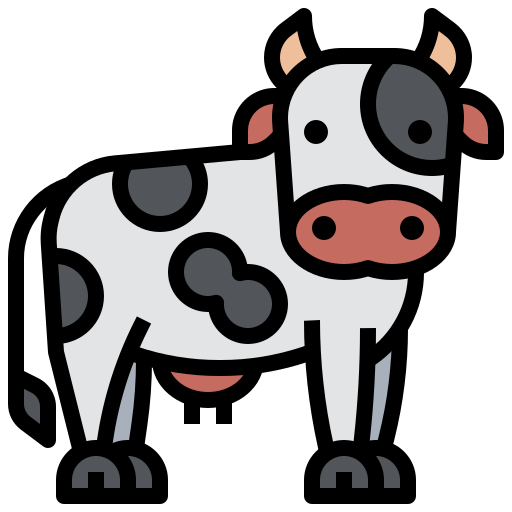
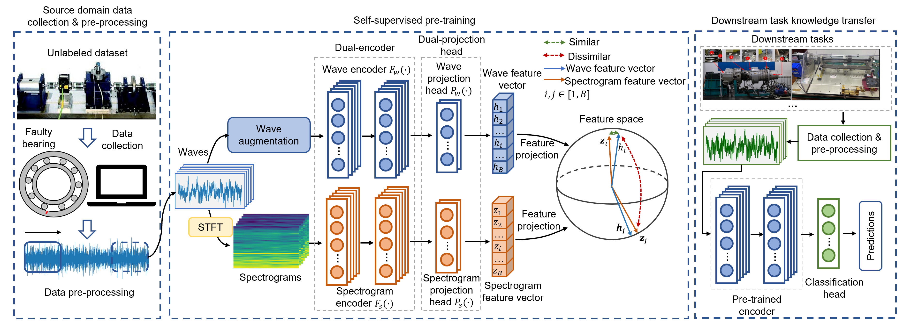
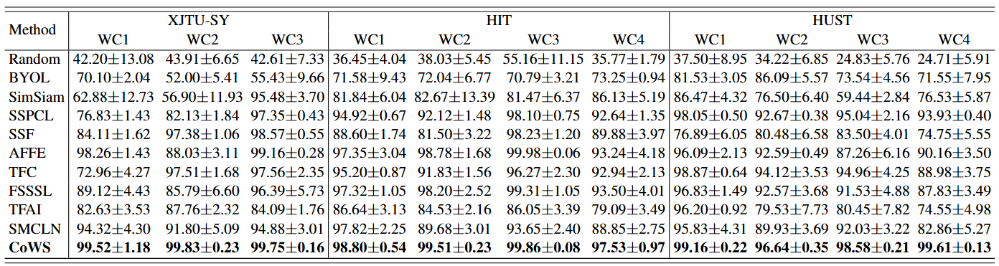

# CoWS: Consistent Wave and Spectrogram

<div align="center">
  
</div>

<div align="center">

[](https://www.python.org/)
[](https://pytorch.org/)
[](LICENSE)
[](https://doi.org/)

</div>

## 📖 Overview

The officieal implementation of the paper: **CoWS: Self-Supervised Representation Pre-Training for Cross-Machine Fault Diagnosis**, which has been accepted by *IEEE Transactions on Emerging Topics in Computational Intelligence*.

**CoWS (Consistent Wave and Spectrogram)** is a novel self-supervised learning method for mechanical fault diagnosis that leverages the consistency between time domain waveforms and time-frequency domain spectrograms. By learning consistent representations across these two complementary views, CoWS achieves superior performance in bearing fault diagnosis tasks.

### Key Features

- 🔄 **Cross-domain Consistency**: Aligns representations between time-domain and frequency-domain views
- 🎯 **Self-supervised Learning**: No labeled data required for pre-training
- 📊 **Multi-view Learning**: Exploits complementary information from wave and spectrogram representations
- ⚡ **Efficient Training**: Limited data required for fine-tuning
- 🚝 **Cross-machine Tasks**: Good performance on cross-machine fault diagnosis tasks

## 🏗️ Architecture

CoWS employs a dual-encoder architecture:

- **Wave Encoder**: 1D ResNet50 for processing time-domain signals
- **Spectrogram Encoder**: 2D ResNet50 for processing frequency-domain representations
- **Contrastive Learning**: Maximizes agreement between wave-spectrogram pairs

> CoWS is a general contrastive learning model. The wave and sepctrogram encoders can be replaced with your self-defined architectures.

<div align="center">
  
</div>


## 🚀 Quick Start

### Prerequisites

- Python 3.7+
- PyTorch 1.8+

### Installation

1. Clone the repository:
```bash
git clone https://github.com/Xiaohan-Chen/CoWS
cd cows
```

2. Install dependencies:
```bash
pip install -r requirements.txt
```

### Data Preparation

Place your bearing data in the `Data/` directory following this structure:
```
Data/
├── Bearing/
│   ├── load0.pkl
│   └── ...
└── HITBearing/
│   ├── load0.pkl
│   └── ...
└── HUSTBearing/
│   ├── load0.pkl
│   └── ...
└── XJTUBearing/
│   ├── load0.pkl
│   └── ...
```

### Training

1. **Pre-training with CoWS**:
```bash
python CoWS.py
```

2. **Linear Evaluation**:
```bash
python Evaluation.py --label_ratio 0.01
```

3. **Transfer Learning**:
```bash
python Transfer.py --tgt_data 'HUSTBearing'--tgt_load 0 --num_train 10
```

## 📊 Experiments



## 📄 Citation

If you find CoWS useful in your research, please consider citing:

```bibtex

```

## 📝 License

This project is licensed under the MIT License - see the [LICENSE](LICENSE) file for details.

## 🥐 See Also
- TFPred: Learning Discriminative Representations from Unlabeled Data for Few-Label Rotating Machinery Fault Diagnosis. [[Paper](https://www.sciencedirect.com/science/article/pii/S0967066124000601)][[GitHub](https://github.com/Xiaohan-Chen/TFPred)]
- Transfer Learning Fault Diagnosis: A Survey. [[Paper](https://ieeexplore.ieee.org/document/10042467)][[GitHub](https://github.com/Xiaohan-Chen/transfer-learning-fault-diagnosis-pytorch)]
- Few-Shot Fault Diagnosis. [[GitHub](https://github.com/Xiaohan-Chen/few-shot-fault-diagnosis)]

## 🙏 Acknowledgments

- Thanks to the self-supervised learning open source community
- Special thanks to the mechanical fault diagnosis public datasets

---

<div align="center">
  <p>⭐ Star this repository if you find it helpful!</p>
</div>